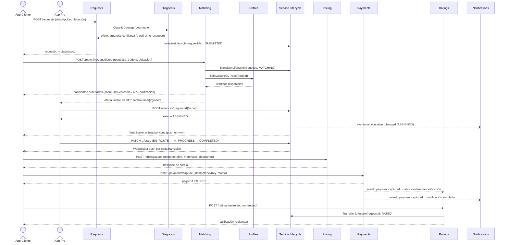

# Diagrama de secuencia — Flujo principal

> Caso de uso: creación de solicitud → diagnóstico → matching → aceptación →
> ejecución → pago → calificación. Corresponde a los endpoints reales
> implementados en `backend/src/modules/*` y documentados en
> `docs/api/openapi.yaml`. Complementa la vista C3 descrita en
> `02-arquitectura-principios.md`, sección 5, con el detalle de los módulos
> que efectivamente se tocan (trazabilidad caso de uso–módulo, criterio P10).

## Notas de trazabilidad

| Paso | Módulo(s) | Escenario de calidad asociado |
|---|---|---|
| Clasificación de daño | Diagnosis, Requests | R1 (degradación si la IA simulada no reconoce el daño) |
| Búsqueda de candidatos | Matching, Profiles | P1 (latencia acotada), ver también ADR-0004 |
| Aceptación del servicio | Service Lifecycle | R2 (sin doble asignación, transición atómica) |
| Seguimiento en vivo | Service Lifecycle → WebSocket | U2 (actualización ≤ 5 s) |
| Captura de pago | Payments | S2 (idempotencia, integridad transaccional) |
| Calificación | Ratings, Service Lifecycle | Cierre del ciclo de vida del servicio (RATED) |
